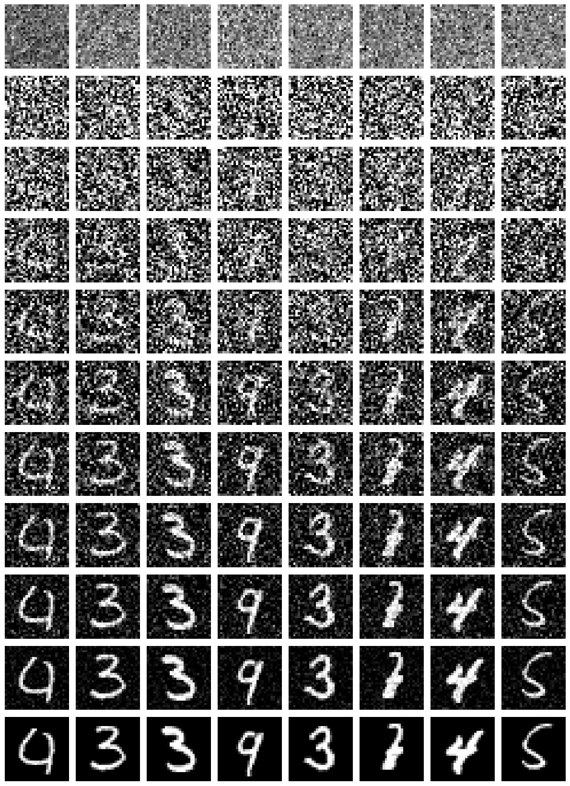
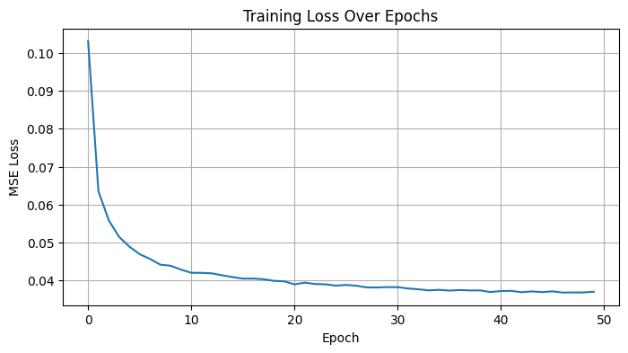

# Denoising Diffusion Probabilistic Model from Scratch


A PyTorch implementation of a Denoising Diffusion Probabilistic Model (DDPM) that generates handwritten digits from pure noise. The notebook builds each component by hand and explains it step by step (in French).



## What is implemented

- **Forward diffusion** over 1,000 timesteps with a cosine noise schedule
- **Reverse diffusion** sampling, with intermediate steps saved for visualization
- **U-Net noise predictor** with residual blocks and sinusoidal time embeddings
- **Self-attention** at the bottleneck to capture global dependencies
- **Training** on MNIST for 50 epochs with AdamW (learning rate 1e-4)

## Results

The MSE noise-prediction loss decreased from about 0.10 to 0.037 over 50 epochs, and the samples are recognizable digits.



| Metric | Value |
| --- | --- |
| Average L2 | 0.1367 |
| Average PSNR | 8.80 dB |
| Average SSIM | 0.1998 |

> **Reading these scores:** the model is unconditional, so a generated digit has no matching real image. Paired metrics such as SSIM and PSNR are therefore indicative only. Fréchet Inception Distance (FID) would be a more suitable measure and is a planned improvement.

## Getting started

```bash
pip install -r requirements.txt
jupyter notebook ddpm_mnist.ipynb
```

MNIST downloads automatically through `torchvision`. A GPU is strongly recommended.

## Reference

Ho, J., Jain, A., & Abbeel, P. (2020). [Denoising Diffusion Probabilistic Models](https://arxiv.org/abs/2006.11239). *NeurIPS 2020*.

## Author

**Yassine Houari** · [LinkedIn](https://www.linkedin.com/in/yassine-houari-/)
